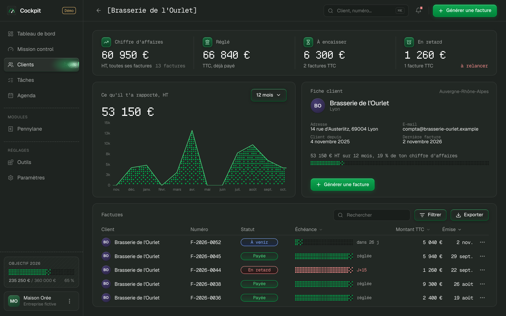
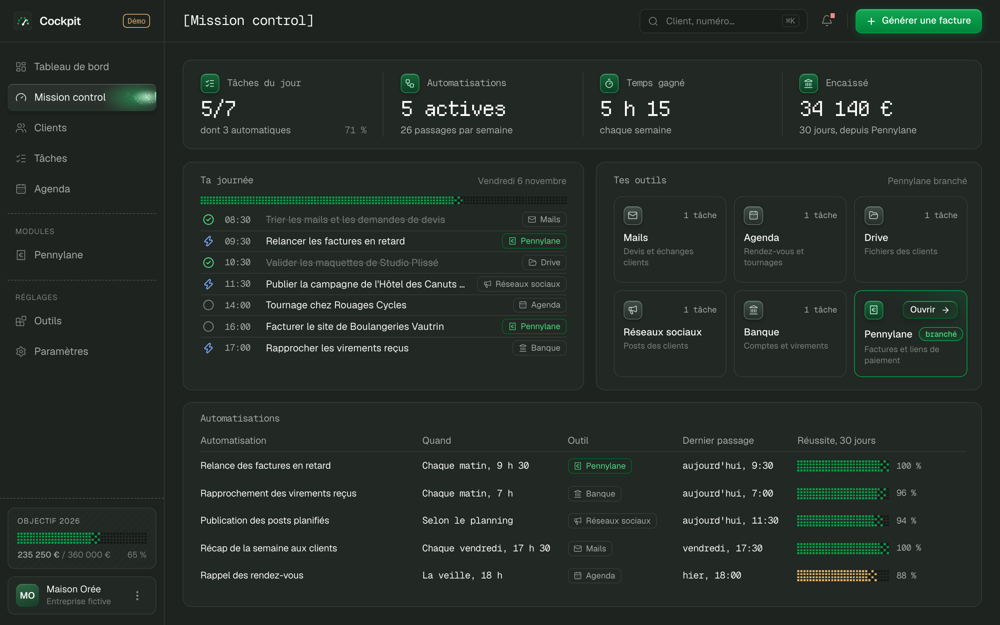
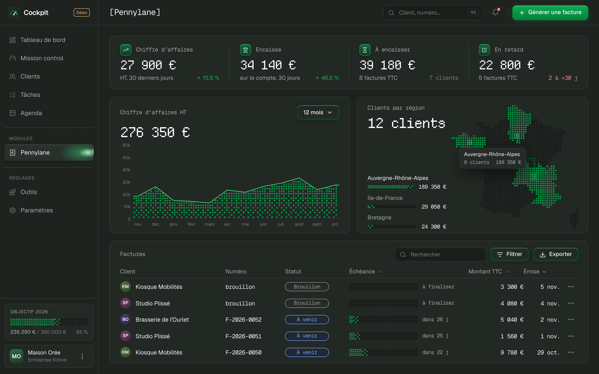
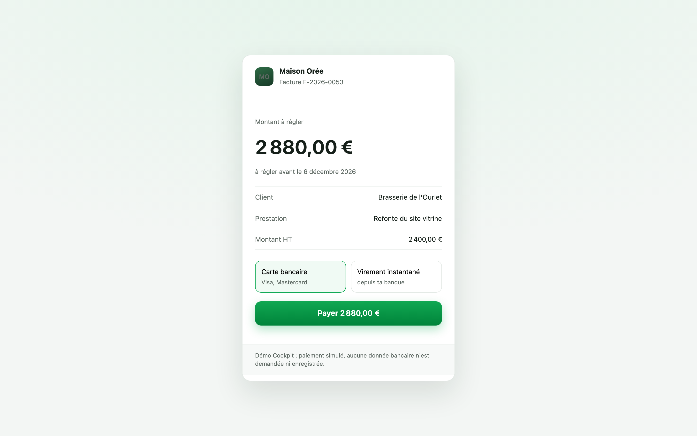

# Cockpit

Le mission control de ta boîte : ton chiffre d'affaires, tes clients, tes prospects, ta journée et tes
automatisations sur un seul écran, avec [Pennylane](https://www.pennylane.com) branché pour créer tes factures,
les envoyer avec leur lien de paiement et suivre ce qui rentre. Le tout tourne sur ton ordinateur, avec une
démo branchée sur un faux Pennylane pour l'essayer sans compte.


## Ce qu'il affiche

**Le tableau de bord**, la page d'accueil : les 4 chiffres clés, la courbe du chiffre d'affaires, tes clients
sur une carte de France, et **tes leads** en bas : chaque prospect, d'où il vient, son étape (nouveau, contacté,
rendez-vous, devis envoyé, gagné ou perdu), le montant espéré et la suite à donner. Les leads se remplissent avec
`src/data/leads.ts`.

**Clients** : tous tes clients, du plus gros chiffre d'affaires sur 12 mois au plus petit, avec ce qu'ils te
doivent. Un clic sur le nom d'un client (ici, ou dans le tableau des factures) ouvre **sa fiche** : ce qu'il t'a
rapporté, ce qu'il a déjà réglé, ce qu'il doit encore et ce qui est en retard, sa courbe sur 12 mois, ses
coordonnées, sa part de ton chiffre d'affaires, ses factures, et « Générer une facture » déjà réglé sur lui.



**Agenda et Tâches** : ta semaine en cinq jours (rendez-vous clients, tournages, appels, points d'équipe), et
toutes les tâches de la semaine à cocher. Ils se remplissent avec `src/data/agenda.ts` ; les tâches du jour sont
celles de Mission control.

**Mission control** :
- les chiffres du jour : tâches faites, automatisations actives, temps gagné chaque semaine, et l'encaissé de Pennylane ;
- **ta journée** : chaque tâche, son heure et l'outil qui sert à la faire ;
- **tes outils**, avec le nombre de tâches qui passent par chacun ;
- **tes automatisations** : quand elles tournent, leur dernier passage et leur taux de réussite.



Ces blocs se remplissent avec le fichier `src/data/mission.ts` : c'est là que tu décris ce que fait ta
boîte, à quel moment et avec quel outil. Seul Pennylane est vraiment branché ; le reste décrit ton organisation.

**Le module Pennylane** :
- **4 chiffres clés** : le chiffre d'affaires HT des 30 derniers jours, ce qui est arrivé sur ton compte, ce qui reste à encaisser et ce qui est en retard ;
- **la courbe du chiffre d'affaires** sur 12 mois ou 6 mois, et tes clients par région sur une carte de France en points ;
- **tes factures** : statut, échéance, recherche, filtre, tri, export CSV, PDF, lien de paiement, renvoi par e-mail ;
- **« Générer une facture »** : Cockpit crée le brouillon, le finalise (Pennylane lui donne son numéro) et l'envoie à ton client par e-mail, en trois appels à l'API que tu vois défiler, puis te donne le lien de paiement ;
- **la relance de toutes les factures en retard en un clic**, depuis la cloche ;
- **les paiements qui arrivent** : quand tu reviens sur Cockpit, une facture réglée passe à « Payée » et l'encaissé se met à jour.




Il y a aussi l'objectif de l'année en bas du menu, un thème sombre et un thème clair, et une intro au
chargement : la courbe se trace, puis les points s'allument de gauche à droite.

### À propos des liens de paiement

L'API de Pennylane ne fabrique pas de lien de paiement à part. Quand le paiement en ligne est activé dans
Pennylane (Stripe connecté à Pennylane, ou le Compte Pro), la facture envoyée par e-mail et son PDF portent un
bouton « Payer maintenant ». Le lien que Cockpit te donne est donc le PDF de la facture, redemandé à chaque fois
parce qu'il expire au bout de 30 minutes. Dans la démo, il ouvre une page de paiement simulée.



## Démarrer

Il te faut [Node.js](https://nodejs.org) 20.19 ou plus récent.

```bash
git clone <adresse-du-depot> cockpit
cd cockpit
npm install
npm run dev
```

Ouvre http://localhost:5180 : tu es sur la démo de Maison Orée, une agence de communication fictive à Lyon,
avec ses 12 clients et ses factures. Elle est branchée dès l'ouverture sur un faux Pennylane
(`server/faux-pennylane.ts`) : il répond comme la vraie API, et Cockpit le lit avec le même code que ton vrai
compte. Les montants sont calés sur la date du jour, et le menu du compte (en bas à gauche) remet la démo à zéro.

## Brancher ton compte Pennylane

1. Dans Pennylane, va dans **Paramètres → Connectivité → Développeurs** et clique sur **Générer un jeton d'API**.
   Il faut l'offre Essentiel ou plus, et seuls les dirigeants et les comptables voient cet onglet.
2. Coche au minimum : **factures clients** en lecture et écriture, **clients** et **transactions** en lecture.
3. Copie le fichier `.env.example` en `.env`, colle ton jeton après `PENNYLANE_API_TOKEN=`, puis relance `npm run dev`.

Le badge en haut du menu passe de « Démo » à « Pennylane ».

**Le jeton reste sur ton ordinateur.** Il vit dans `.env` (ignoré par git) et n'est lu que par le petit
serveur local de Cockpit : il n'est jamais envoyé au navigateur. Le serveur n'écoute que ton ordinateur.
Ne mets pas Cockpit en ligne sans ajouter une vraie connexion : n'importe qui pourrait lire tes chiffres
et créer des factures.

## Comment les chiffres sont calculés

| Chiffre | Calcul |
|---|---|
| Chiffre d'affaires | Total HT des factures émises ces 30 derniers jours (hors brouillons, avoirs déduits), comparé aux 30 jours d'avant |
| Encaissé | Entrées d'argent rattachées à un client sur ton compte bancaire, ces 30 derniers jours |
| À encaisser | Reste à payer TTC des factures envoyées et pas encore réglées |
| En retard | La part de ces factures dont l'échéance est passée |
| Courbe | Total HT par tranches de 30 jours (12 mois) ou de 14 jours (6 mois) |
| Clients par région | Total HT des 12 derniers mois, d'après l'adresse de facturation de chaque client |
| Objectif de l'année | Total HT depuis le 1ᵉʳ janvier. Règle-le avec `COCKPIT_OBJECTIF_ANNUEL` ; sans réglage, Cockpit vise +10 % sur tes 12 derniers mois |
| Temps gagné | Pour chaque automatisation de `src/data/mission.ts` : minutes gagnées à chaque passage × passages par semaine |

## Sous le capot

- **React 19, TypeScript et Vite**, du CSS sans bibliothèque d'interface. Les points sont dessinés sur des canvas.
- **`server/`** : l'API locale, branchée dans le serveur de Vite. `pennylane.ts` parle à la [Company API v2](https://pennylane.readme.io/reference). Sans jeton, il parle à `faux-pennylane.ts`, qui répond comme elle (mêmes chemins, mêmes champs) avec les données de `demo.ts`. `tableau.ts` fait tous les calculs, les mêmes pour les deux.
- **Sur ordinateur, tout tient dans la fenêtre** : les styles sont écrits en pixels d'une maquette de 1280 × 820, puis convertis en rem, et la taille de base suit la fenêtre. Sur téléphone, la page défile.
- `npm run build` vérifie les types et construit la page. `npm start` sert la version construite, avec l'API, sur le même port.

## Crédits

- Polices : [Geist et Geist Mono](https://vercel.com/font) (Vercel) et [Departure Mono](https://departuremono.com) (Helena Zhang), sous licence SIL Open Font License.
- Icônes : [Lucide](https://lucide.dev) (licence ISC).
- Tracés des régions : IGN Admin Express (Licence ouverte), simplifiés par [france-geojson](https://github.com/gregoiredavid/france-geojson). La carte en points se régénère avec `scripts/carte-france.py`.
- Le style visuel s'inspire du dashboard Overseer d'[Adeebrq](https://github.com/Adeebrq). Aucun code n'en est repris.

Cockpit n'est pas un produit de Pennylane : c'est un projet libre qui utilise son API publique.

## Licence

MIT, voir [LICENSE](LICENSE).
