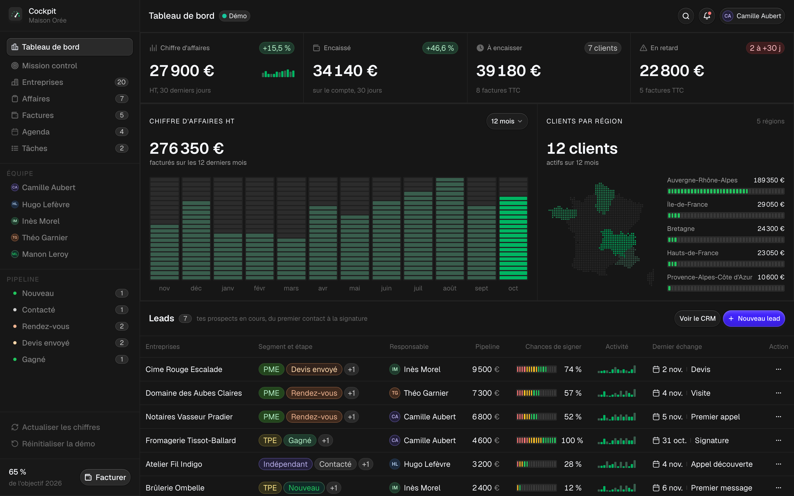
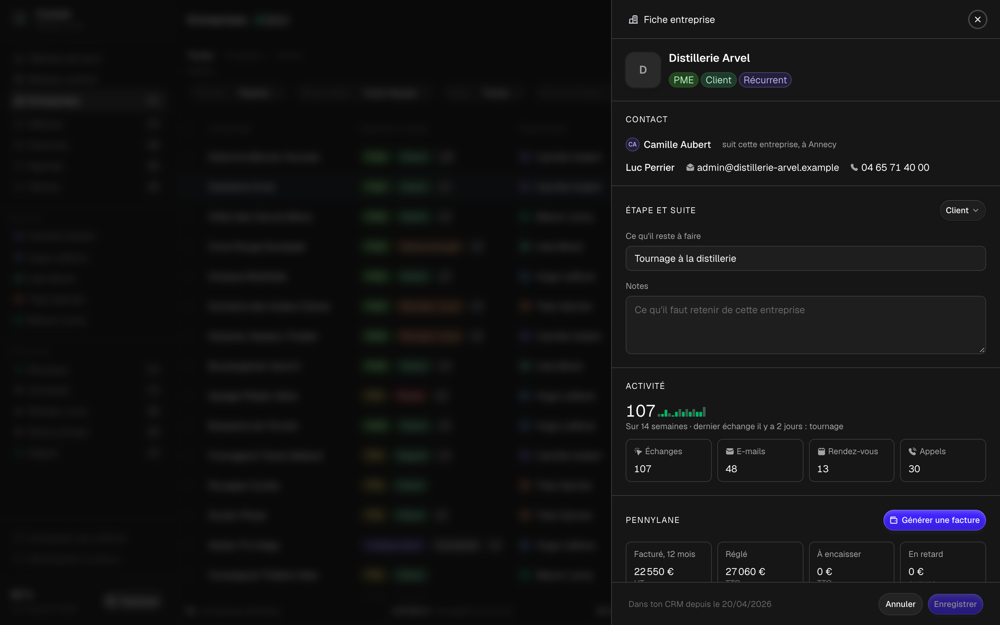
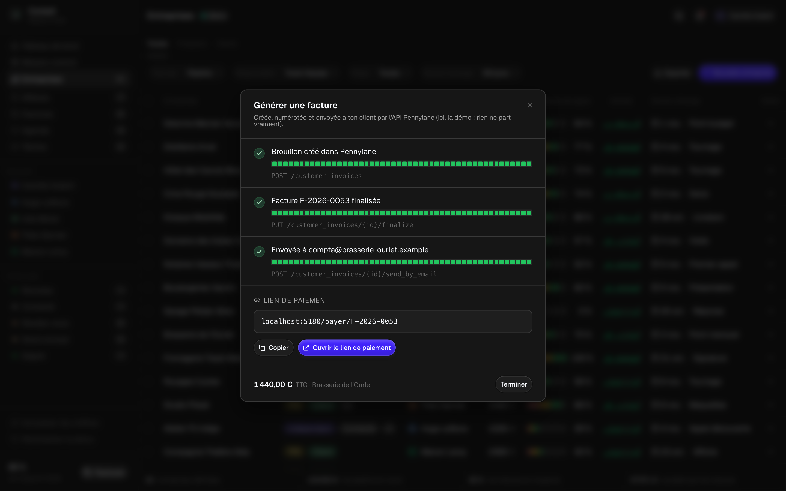

# Cockpit

Le mission control de ta boîte : **ton CRM**, **tes factures Pennylane**, ton chiffre d'affaires, ta journée,
ton agenda et tes tâches sur un seul écran. Cockpit tourne sur ton ordinateur, avec une démo branchée sur un
faux Pennylane pour l'essayer sans compte.

Le CRM et le style de l'appli viennent du [Sales CRM de Kargul Studio](https://github.com/kargulstudio/sales-crm)
(licence MIT) : on l'a traduit, branché sur une vraie sauvegarde et relié à Pennylane.



## Ce qu'il affiche

**Le tableau de bord**, la page d'accueil : les 4 chiffres clés de Pennylane (chiffre d'affaires, encaissé,
à encaisser, en retard), le chiffre d'affaires mois par mois, tes clients sur une carte de France, et **tes
leads** : chaque prospect avec son segment, son étape, son responsable, ce qu'il peut te rapporter, tes chances
de signer et son activité.

**Entreprises**, le CRM : tous tes prospects et tes clients dans un tableau à trier et à filtrer (responsable,
étape, dernier échange), à exporter en CSV. Un clic ouvre **la fiche** : le contact, l'étape et la suite à
donner, la santé du pipeline, l'activité, et pour un client **ses factures Pennylane**, avec « Générer une
facture » déjà réglé sur lui.



**Affaires** : ton pipeline en colonnes, du premier contact à la signature. Glisse une carte vers une autre
colonne pour changer son étape.

**Factures**, le module Pennylane :
- tes factures avec leur statut et leur échéance, à filtrer, trier et exporter, avec le PDF, le lien de paiement et le renvoi par e-mail ;
- **« Générer une facture »** : Cockpit crée le brouillon, le finalise (Pennylane lui donne son numéro) et l'envoie à ton client par e-mail, en trois appels à l'API que tu vois défiler, puis te donne le lien de paiement ;
- **la relance de toutes les factures en retard en un clic**, depuis la cloche ;
- **les paiements qui arrivent** : quand tu reviens sur Cockpit, une facture réglée passe à « Payée » et l'encaissé se met à jour.



**Mission control** : ce que fait ta boîte, à quel moment et avec quel outil. Ta journée, tes outils, tes
automatisations, le temps qu'elles te font gagner. **Agenda** et **Tâches** : ta semaine en cinq jours et toutes
ses tâches.

## Démarrer

Il te faut [Node.js](https://nodejs.org) 20.9 ou plus récent.

```bash
git clone https://github.com/Tephraaa/cockpit.git cockpit
cd cockpit
npm install
npm run dev
```

Ouvre http://localhost:5180 : tu es sur la démo de Maison Orée, une agence de communication fictive à Lyon,
avec son équipe, ses 12 clients, ses 8 prospects et ses factures. Elle est branchée dès l'ouverture sur un faux
Pennylane (`server/faux-pennylane.ts`) : il répond comme la vraie API, et Cockpit le lit avec le même code que
ton vrai compte. « Réinitialiser la démo », en bas du menu, la remet à zéro.

## Brancher ton compte Pennylane

1. Dans Pennylane, va dans **Paramètres → Connectivité → Développeurs** et clique sur **Générer un jeton d'API**.
   Il faut l'offre Essentiel ou plus, et seuls les dirigeants et les comptables voient cet onglet.
2. Coche au minimum : **factures clients** en lecture et écriture, **clients** et **transactions** en lecture.
3. Copie le fichier `.env.example` en `.env`, colle ton jeton après `PENNYLANE_API_TOKEN=`, puis relance `npm run dev`.

Le badge à côté du titre passe de « Démo » à « Pennylane », et chaque client Pennylane entre dans ton CRM, à
l'étape « Client ».

**Le jeton reste sur ton ordinateur.** Il vit dans `.env` (ignoré par git) et n'est lu que par le serveur local
de Cockpit : il n'est jamais envoyé au navigateur. Ne mets pas Cockpit en ligne sans ajouter une vraie
connexion : n'importe qui pourrait lire tes chiffres et créer des factures.

## Tes données

| Quoi | Où |
|---|---|
| Ton CRM (entreprises, équipe, étapes) | `.cockpit/crm.json`, créé au premier lancement et ignoré par git. La démo a le sien : `.cockpit/crm-demo.json` |
| Ta journée, tes outils, tes automatisations | `data/mission.ts` |
| Ton agenda et les tâches de la semaine | `data/agenda.ts` |
| Tes factures, tes clients, tes encaissements | Pennylane, lus par l'API |

Le plus simple pour tout remplir : ouvre Claude Code dans le dossier et demande-lui. Par exemple : « importe mes
prospects depuis ce fichier CSV dans le CRM », ou « remplis data/mission.ts avec ma journée type ».

## Comment les chiffres sont calculés

| Chiffre | Calcul |
|---|---|
| Chiffre d'affaires | Total HT des factures émises ces 30 derniers jours (hors brouillons, avoirs déduits), comparé aux 30 jours d'avant |
| Encaissé | Entrées d'argent rattachées à un client sur ton compte bancaire, ces 30 derniers jours |
| À encaisser | Reste à payer TTC des factures envoyées et pas encore réglées |
| En retard | La part de ces factures dont l'échéance est passée |
| Barres du chiffre d'affaires | Total HT par tranches de 30 jours (12 mois) ou de 14 jours (6 mois) |
| Clients par région | Total HT des 12 derniers mois, d'après l'adresse de facturation de chaque client |
| Objectif de l'année | Total HT depuis le 1ᵉʳ janvier. Règle-le avec `COCKPIT_OBJECTIF_ANNUEL` ; sans réglage, Cockpit vise +10 % sur tes 12 derniers mois |
| Pipeline pondéré | Pour chaque affaire en cours : montant espéré × chances de signer |
| Temps gagné | Pour chaque automatisation de `data/mission.ts` : minutes gagnées à chaque passage × passages par semaine |

## Sous le capot

- **Next.js 16, React 19, TypeScript et Tailwind CSS 4**, avec les composants Radix et le style du Sales CRM de Kargul Studio.
- **`server/`** : l'API locale, servie par `app/api/[...chemin]/route.ts`. `pennylane.ts` parle à la [Company API v2](https://pennylane.readme.io/reference). Sans jeton, il parle à `faux-pennylane.ts`, qui répond comme elle avec les données de `demo.ts`. `tableau.ts` fait les calculs, `crm.ts` garde le CRM.
- Les requêtes qui modifient quelque chose refusent les appels venus d'un autre site et ceux qui ne sont pas en JSON.
- `npm run check` vérifie les types. `npm run build` puis `npm start` servent la version construite sur le même port.

## Crédits

- Le CRM, la structure de l'interface et ses icônes : [Sales CRM](https://github.com/kargulstudio/sales-crm) de Kargul Studio, sous licence MIT.
- Police : [Geist](https://vercel.com/font) (Vercel), sous licence SIL Open Font License. Icônes complémentaires : [Lucide](https://lucide.dev) (licence ISC).
- Tracés des régions : IGN Admin Express (Licence ouverte), simplifiés par [france-geojson](https://github.com/gregoiredavid/france-geojson). La carte en points se régénère avec `scripts/carte-france.py`.

Cockpit n'est pas un produit de Pennylane : c'est un projet libre qui utilise son API publique.

## Licence

MIT, voir [LICENSE](LICENSE).
